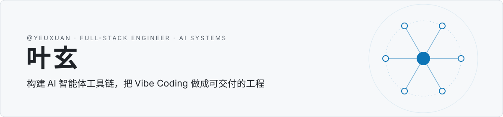

<picture>
  <source media="(prefers-color-scheme: dark)" srcset="assets/banner-dark.svg">
  
</picture>

全栈工程师，专注 AI 智能体工程与 Vibe Coding：用 AI 编码智能体完成从需求到上线的完整交付，并把实践沉淀为工具、文档和课程。

## 正在做

**[MCPane](https://github.com/yeuxuan/mcpane)** · Claude Code、Codex 与 MCP 生态的统一桌面控制面 
一次配置 MCP Server，所有 AI 客户端共用；每次配置写入可预览、可回滚。支持 macOS / Windows。

**[OpenClaw 中文文档站](https://github.com/yeuxuan/openclaw-docs)** · 767 篇教程与源码剖析，751 ★ 
覆盖安装部署、Gateway 控制平面、Agent 执行链路与上下文工程，面向中文开发者。[在线阅读 →](https://openclaw-docs.dx3n.cn)

**[FDE 实战课](https://github.com/yeuxuan/fde-teach)** · 前沿部署工程师（Forward Deployed Engineer）中文实战课 
9 个模块，从 Prompt、RAG、Agent、MCP 到评估与客户现场交付。

## 开源作品

**[Ace-Mcp-Node](https://github.com/yeuxuan/Ace-Mcp-Node)** · 359 ★ 
面向 AI 助手的代码库索引与语义搜索 MCP Server，支持增量更新与 Web 管理界面。

## 技术栈

- **AI 工程**　MCP · Agent · RAG · Prompt / Context Engineering · Claude Code · Codex
- **前端**　TypeScript · Vue · VitePress / Astro
- **后端**　Node.js · Go · Python · C# / .NET · Rust

## 联系

[博客 dx3n.cn](https://www.dx3n.cn) · [GitHub](https://github.com/yeuxuan)
