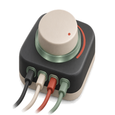

# Hi 👋，我是阿强

<picture>
  <source media="(prefers-color-scheme: dark)" srcset="assets/avatar-dark.gif">
  
</picture>

你好呀，我是**阿强**，也就是 GitHub 上的 yeuxuan。

全栈工程师 🧑‍💻 · AI 智能体工程 🤖 · Vibe Coding ✨。代码交给智能体，交付由我负责。

Hey! I'm A-Qiang (yeuxuan), a full-stack engineer working on AI agent engineering and vibe coding. Agents write the code; I own the delivery.

## 作品

<table>
  <tr>
    <td></td>
    <td><a href="https://github.com/yeuxuan/mcpane"><b>MCPane</b></a> Claude Code、Codex 与 MCP 生态的统一桌面控制面，14 款 AI 客户端统一接入，已发布 8 个版本</td>
  </tr>
  <tr>
    <td></td>
    <td><a href="https://github.com/yeuxuan/openclaw-docs"><b>OpenClaw 中文文档</b></a> 767 篇安装教程与源码剖析，700+ Stars</td>
  </tr>
  <tr>
    <td></td>
    <td><a href="https://github.com/yeuxuan/fde-teach"><b>FDE 实战课</b></a> 面向零基础的前沿部署工程师中文课程，9 个模块</td>
  </tr>
  <tr>
    <td></td>
    <td><a href="https://github.com/yeuxuan/Ace-Mcp-Node"><b>Ace-Mcp-Node</b></a> 为 AI 助手提供代码库索引与语义搜索的 MCP Server，300+ Stars</td>
  </tr>
</table>

## 技术栈

<picture>
  <source media="(prefers-color-scheme: dark)" srcset="https://skillicons.dev/icons?i=ts%2Cvue%2Cnodejs%2Cgo%2Cpy%2Ccs%2Crust&theme=dark">
  
</picture>

---

博客 [dx3n.cn](https://www.dx3n.cn) · 项目相关的问题请在对应仓库提 Issue
