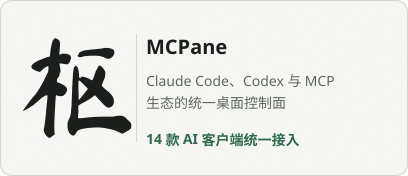
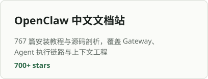
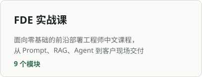

<picture>
  <source media="(prefers-color-scheme: dark)" srcset="assets/banner-dark.svg">
  
</picture>

## 作品

<a href="https://github.com/yeuxuan/mcpane"><picture><source media="(prefers-color-scheme: dark)" srcset="assets/card-mcpane-dark.svg"></picture></a>
<a href="https://github.com/yeuxuan/openclaw-docs"><picture><source media="(prefers-color-scheme: dark)" srcset="assets/card-openclaw-dark.svg"></picture></a>
<a href="https://github.com/yeuxuan/fde-teach"><picture><source media="(prefers-color-scheme: dark)" srcset="assets/card-fde-dark.svg"></picture></a>
<a href="https://github.com/yeuxuan/Ace-Mcp-Node"><picture><source media="(prefers-color-scheme: dark)" srcset="assets/card-ace-dark.svg"></picture></a>

## 方法

**只做能交付的东西。** MCPane 已发布 8 个版本、累计 500+ 次下载，不停留在 demo。

**把复杂讲成简单。** 767 篇中文文档和一门 FDE 课程，把英文生态里的框架与源码拆开讲给中文开发者。

**按问题选技术。** TypeScript、Vue、Node.js、Go、Python、C#、Rust，哪个最合适就用哪个。

## 联系

博客 [dx3n.cn](https://www.dx3n.cn)。项目相关的问题请在对应仓库提 Issue。
